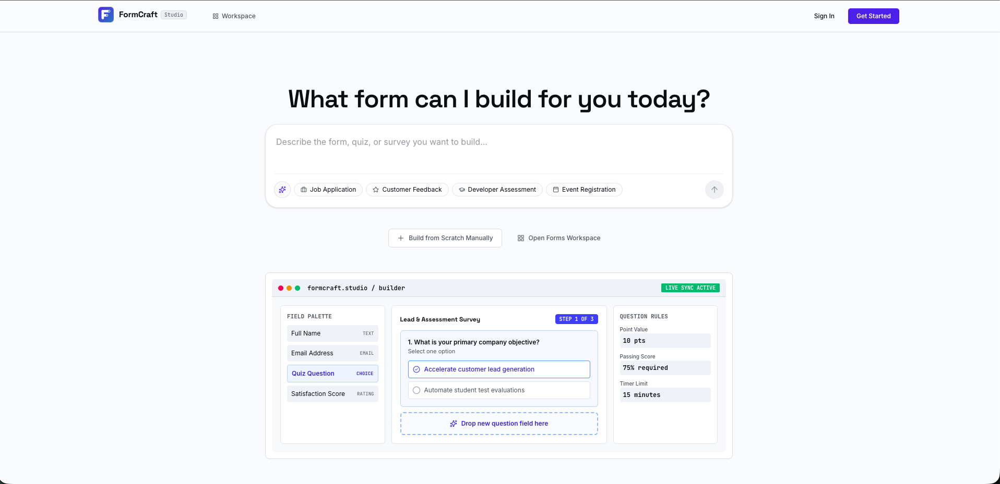

# FormCraft Studio 📝

A modern, AI-powered form and quiz builder built with Next.js 16, React 19, and Tailwind CSS. Create dynamic forms from natural language prompts or build them visually using an intuitive drag-and-drop canvas.

---

## 🌐 Live Website

🔗 **[Visit Live Website](https://your-live-url.com)** *(Replace with your deployed URL)*

---

## 📸 Preview



---

## 🚀 Key Features

- **AI Form Generation**: Generate complete forms and quizzes from natural language prompts.
- **Visual Drag & Drop**: Easily rearrange questions and sections using `@dnd-kit`.
- **Conditional Logic**: Dynamically show or hide fields based on user responses.
- **Quiz Mode & Auto-Grading**: Configure answer keys, explanations, and passing scores with instant feedback.
- **File Uploads & Previews**: Upload documents and media with interactive in-browser previews.
- **Submissions & Analytics**: Review, search, and filter responses in a clean data table with custom pagination.

---

## 🛠️ Quick Start

```bash
# 1. Install dependencies
npm install

# 2. Configure environment
cp .env.example .env

# 3. Start development server
npm run dev
```

Open [http://localhost:3000](http://localhost:3000) in your browser.
